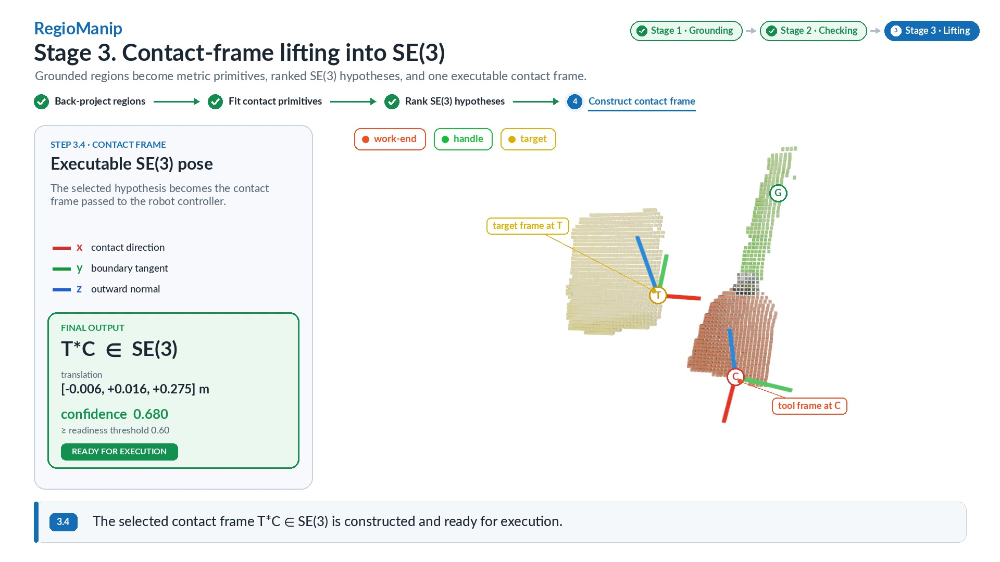

# RegioManip

## Region-Level Affordances for Zero-Shot Wrench-Bounded Tool Manipulation

Dourjoy Debnath Rup, Shakir Muhammad Afzal ul Haq, Wenzhe Zheng, Lijin Yang, Sen Du, Dhali Md Sabuj, Qimin Li\*, and Fuqiang Liu\*

College of Mechanical and Vehicle Engineering, Chongqing University, Chongqing 400044, China  
\* Corresponding authors: qimin_li@cqu.edu.cn, liufq@cqu.edu.cn

[**Project website**](https://dourjoyrup.github.io/RegioManip-project/) · [**Paper**](Manuscript/regiomanip.pdf) · [**Final video**](results/video/regiomanip_stage1_stage2_stage3_final/regiomanip_stage1_stage2_stage3_FINAL.mp4) · [**Reproduce video**](reproduce_final_video.sh)

RegioManip converts grounded tool regions into physically meaningful affordance hypotheses and ranked SE(3) contact frames for contact-rich, zero-shot manipulation.

[](results/video/regiomanip_stage1_stage2_stage3_final/regiomanip_stage1_stage2_stage3_FINAL.mp4)

> Select the image above to open the complete 1080p pipeline video.

## Abstract

Contact-rich tool manipulation remains a last-mile challenge for embodied artificial intelligence and industrial robotics, because many real tasks require sustained physical interaction rather than simple pose reaching. Recent vision-language model (VLM) pipelines improve open-vocabulary grounding and instruction following, but their keypoint- or waypoint-centric outputs often commit to a single prediction and do not explicitly encode contact-frame stability, wrench limits, or perceptual uncertainty. We present **RegioManip**, an AI-driven zero-shot framework that converts grounded tool regions into wrench-bounded action constraints for contact-rich manipulation. Given a single RGB-D observation and a natural-language instruction, RegioManip grounds each task-relevant region into grasp-type, contact-geometry, force-mode, and contact-face attributes, cross-checks them against geometry-only estimates, and prunes infeasible combinations through a physics-consistency lattice. The resulting ranked affordance hypotheses are lifted into SE(3) contact-frame hypotheses and executed with force and torque budgets derived from the grasp wrench space of the resolved contact. Confidence-adaptive strictness and hierarchical repair enable robust execution under perceptual uncertainty. On a JAKA Zu3 across six industrial tool operations, RegioManip achieves **80.8% average open-world success**, compared with **65.0% for GeoManip** and **57.5% for MOKA**, and reaches **90.8% success with a FoundationPose prior** versus **86.7% for ToolManip**.

## Visual pipeline

| Stage | Purpose | Visual output |
|---|---|---|
| 1. Region-level affordance grounding | Ground task-relevant tool and target regions from RGB-D and language | Structured five-image VLM prompt and `RegionAffordanceTuple` |
| 2. Geometry checking and lattice pruning | Cross-check semantic assignments against geometry and reject physically inconsistent triples | Ranked grasp/contact/force affordance hypothesis |
| 3. Contact-frame lifting into SE(3) | Clean depth, back-project regions, fit primitives, rank fixed-origin frame orientations | Selected executable contact frame with confidence |

The included video presents these stages using the stored experimental outputs. Display exposure, line weights, transitions, and coordinate-axis styling do not modify the underlying RGB-D observations, masks, scores, or transformations.

## Repository contents

```text
.
├── README.md                         # Public GitHub landing page
├── LICENSE
├── CITATION.cff
├── Manuscript/                       # Paper (preprint)
├── data/000/                         # RGB-D example used by the video
├── regiomanip/                       # Core grounding and perception code
├── scripts/                          # Stage 1–3 publication-video renderers
├── results/regiomanip2/              # Stored experimental evidence
├── results/video/.../                # One complete final MP4
├── index.html                        # GitHub Pages project website
├── style.css                         # Website design
├── docs/assets/                      # Website preview media
└── reproduce_final_video.sh          # End-to-end video reproduction
```

## Installation

```bash
conda create -n regiomanip python=3.10 -y
conda activate regiomanip
pip install -r requirements.txt
pip install -e .
```

The complete perception pipeline additionally requires compatible Grounding DINO and SAM/SAM 2 installations and their model checkpoints. Model weights are intentionally not included in this repository.

## Reproduce the final video

From the repository root:

```bash
bash reproduce_final_video.sh
```

The script regenerates the intermediate stages and writes the complete video to:

```text
results/video/regiomanip_stage1_stage2_stage3_final/
└── regiomanip_stage1_stage2_stage3_FINAL.mp4
```

Open3D may use headless Vulkan/llvmpipe when X11 is unavailable. This is expected for server-side rendering.

## Enable the project website

The static website is ready in [`index.html`](index.html).

The website is served by GitHub Pages from the `main` branch, `/ (root)` folder, at
<https://dourjoyrup.github.io/RegioManip-project/>.

## Citation

Citation metadata is provided in [`CITATION.cff`](CITATION.cff). Until a DOI or final journal citation is available, cite the manuscript title and authors shown there.

## License

The code is released under the [MIT License](LICENSE). The manuscript, figures, video, data, third-party models, and external dependencies may be subject to their own terms.

## Development provenance

The internal continuation notes are retained at [`docs/DEVELOPMENT_HANDOFF.md`](docs/DEVELOPMENT_HANDOFF.md) for reproducibility. They are not the public project introduction.
